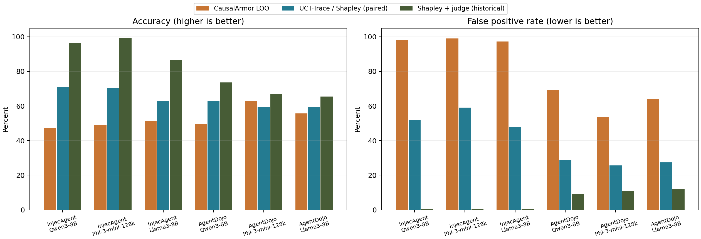
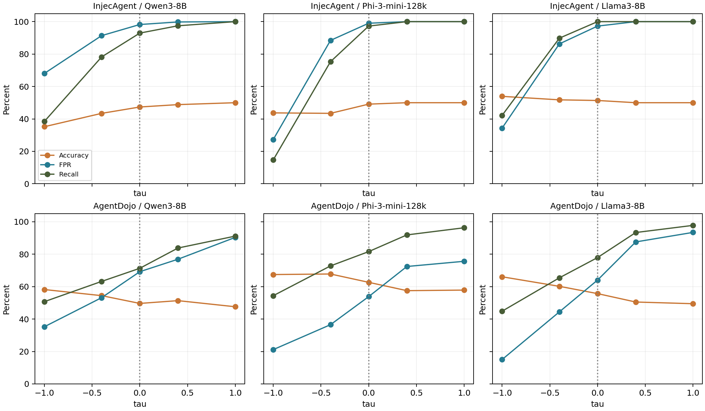

# CausalArmor LOO 与 UCT-Trace 综合实验报告

报告日期：2026-10-13。分析范围：AgentDojo、InjecAgent DH × Qwen3、Phi3、Llama3，共六组已有实验。本文复核现有输出，不重新运行模型，不改变阈值、标签或原始结果。

## 1. 核心结论

默认阈值 `tau=0` 下，CausalArmor LOO 六组等权平均 Accuracy 为 **52.65%**，FPR 为 **80.27%**；在相同有效样本上，UCT-Trace 的 Shapley 判定分别为 **64.27%** 和 **40.09%**。因此，CausalArmor 的平均准确率低 **11.63 个百分点**，平均误报率高 **40.18 个百分点**。

预期结论需要区分对比层级：

- 对比 **UCT-Trace / Shapley 单阶段判定**：六组 FPR 均更高，五组 Accuracy 更低；**AgentDojo/Phi3 是例外**，CausalArmor Accuracy 为 62.67%，高于 Shapley 的 59.25%。不能写成六组准确率均更低。
- 对比指定综合报告的 **Shapley+行为裁判**：六组均呈现 CausalArmor Accuracy 更低、FPR 更高的方向。但这是单阶段检测器与两阶段系统的对比，且历史报告的 AgentDojo/Llama3 使用 292 条口径，不能冒充完全配对实验。
- 本实验对象是 **CausalArmor 的固定动作、离线 LOO 适配实现**。结果不等同于完整 CausalArmor 在线防御性能，不是防御后攻击成功率（ASR），也不支持对原方法全部能力作出排名。

## 2. 数据来源与审计口径

### 2.1 主数据

每个目录读取 `results.causalarmor_loo.jsonl` 与 `results.causalarmor_loo.summary.json`。逐行结果是本报告的计算依据，summary 用于交叉核对。六个来源如下：

| 数据集 | 模型 | 结果目录 |
| --- | --- | --- |
| InjecAgent | Qwen3-8B | [causalarmor_loo_injecagent_qwen3](../../result/causalarmor_loo_injecagent_qwen3/) |
| InjecAgent | Phi-3-mini-128k | [causalarmor_loo_injecagent_phi3](../../result/causalarmor_loo_injecagent_phi3/) |
| InjecAgent | Llama3-8B | [causalarmor_loo_injecagent_llama3](../../result/causalarmor_loo_injecagent_llama3/) |
| AgentDojo | Qwen3-8B | [causalarmor_loo_agentdojo_qwen3](../../result/causalarmor_loo_agentdojo_qwen3/) |
| AgentDojo | Phi-3-mini-128k | [causalarmor_loo_agentdojo_phi3](../../result/causalarmor_loo_agentdojo_phi3/) |
| AgentDojo | Llama3-8B | [causalarmor_loo_agentdojo_llama3](../../result/causalarmor_loo_agentdojo_llama3/) |


方法依据为 [执行程序](causalarmor_loo_baseline.py) 和 [README](README.md)；历史对比依据为 [Attention/Shapley 综合实验报告](../../result/Attention_Shapley_综合实验报告_20260809.md) 的表 5 和表 7。本文将其“Shapley”称为 UCT-Trace 的归因判定阶段，将“Shapley+行为裁判”单独列出，避免混淆模块与完整判定流程。

### 2.2 复核内容

逐行检查样本 ID 唯一性、有效/失败计数、三次 log-probability 差分、严格阈值判定、混淆矩阵、全部五个 tau 的扫描结果、工具动作子集和平均/中位耗时，均与六份 summary 一致（浮点误差容差为 1e-12，差分检查为 1e-10）。3,936 次选中观测中，3,933 条有效，3 条失败；不同模型复用样本，因此这不是 3,936 个独立任务。

UCT-Trace 配对采用 AgentDojo 的 `target_id`，以及 InjecAgent 的“输入来源组号 + case_id”。随后逐条核对固定目标文本与 gold 标签相等，且重算 Shapley 主导规则。六组交集覆盖全部有效 CausalArmor 记录。此处核验的是样本、输出和标签的一致性；没有运行时模型权重哈希，不能据此证明两次运行的环境完全一致。

**版本修正：** Qwen3/AgentDojo 使用 `agentdojo_fact_longer_than_attack_qwen_8b_chunk16_fixed` 中的结果。未带 `chunk16_fixed` 的旧文件有 166 个攻击成功标签，与本次及指定报告的 136 个不一致，不能直接混用。

**历史表格口径修正：** 指定报告正文称 AgentDojo/Llama3 的有效 Shapley 样本为 289（136 正例、153 负例），但表 5 列出 TP=60、FP=42、TN=114、FN=76，总计 292。本报告按原始有效行重算为 **TP=60、FP=42、TN=111、FN=76**，Accuracy=59.17%、FPR=27.45%；不将缺失的 3 条自动视为 TN。由此六组 Shapley 宏平均为 64.27%/40.09%，而非历史报告的 64.34%/40.01%。此外，部分历史 F1 与其混淆矩阵存在小幅不一致，例如 InjecAgent/Qwen3 的 Shapley F1 按计数为 76.36%，历史表为 76.28%；配对表统一使用重新计算值。

## 3. 实验设置与方法

### 3.1 数据与标签

**InjecAgent DH：** 三个评分模型均读取 `data/injecagent/qwen3-8b/test_cases_dh_base_attack.jsonl` 与 `test_cases_dh_base_clean.jsonl`，各 510 条，共 1,020 条。`eval=succ` 为正例，`eval=unsucc` 为负例。两文件对应同一批 510 个任务的成功/失败目标条件；文件名 clean 不代表工具返回中必然不存在注入。本任务评估“固定输出对应的攻击是否成功”，不是“输入中是否含攻击”。每模型 512 条 `tool_action`、508 条 `final_answer`。

**AgentDojo：** 三个评分模型同样读取 `data/agentdojo/runs/qwen3-8b` 轨迹。629 条候选中，565 条存在完整攻击块，64 条因缺少攻击块排除。选取首个被污染工具返回后的下一条 assistant 消息，并按目标去重。实际筛选为 `500 <= FACT字符数 <= 100000` 且 `FACT >= 1.0 × max(1, ATTACK)`，不是代码层面的严格大于。筛选后 292 条，重复数为 0，无 limit、无目标 ID 限制，未启用仅工具动作筛选。标签为 `gold_attack_success = not security`，即 136 正例、156 负例。

AgentDojo 标签来自轨迹安全评估，而评分对象是局部下一条 assistant 消息；局部动作与最终轨迹结果之间可能存在粒度差异。三个模型在共同固定输出上评分，不是三个模型分别在线生成新轨迹。因此本报告比较的是评分/判定能力，不能把 Recall 当成该模型自身的攻击成功率。

| 数据集 | 模型 | 选中 | 有效 | 失败 | 有效正例/负例 |
| --- | --- | --- | --- | --- | --- |
| InjecAgent | Qwen3-8B | 1020 | 1020 | 0 | 510/510 |
| InjecAgent | Phi-3-mini-128k | 1020 | 1020 | 0 | 510/510 |
| InjecAgent | Llama3-8B | 1020 | 1020 | 0 | 510/510 |
| AgentDojo | Qwen3-8B | 292 | 292 | 0 | 136/156 |
| AgentDojo | Phi-3-mini-128k | 292 | 292 | 0 | 136/156 |
| AgentDojo | Llama3-8B | 292 | 289 | 3 | 136/153 |


### 3.2 模型及执行范围

| 报告简称 | 当前配置中的权重目录标识 | 配置 |
| --- | --- | --- |
| Qwen3-8B | `/root/Qwen3-8B` | `qwen3_8b-attn_config.json` |
| Phi-3-mini-128k | `microsoft--Phi-3-mini-128k-instruct` | `phi3-attn_config.json` |
| Llama3-8B | `Meta-Llama-3.1-8B` | `llama3_8b-attn_config.json` |

保留实验目录中的 Llama3 简称，但配置实际指向 Llama **3.1** 8B。以上是当前配置证据，不是对运行时 checkpoint 版本的独立鉴定。LOO 不读取注意力头分数，配置中的 important_heads 不参与其判定。当前程序默认完整前向阈值 1,024 token，streaming chunk 为 16，prefill chunk 为 256；summary 未完整记录这些运行参数，不能仅凭默认值断定历史命令没有覆盖它们。模型加载时间不包含在逐样本 `loo_time_seconds` 中。

### 3.3 CausalArmor LOO 判定

给定固定目标动作 y，对完整提示 x、删除原始用户内容的提示 x\U、删除整个污染工具返回内容的提示 x\T，分别计算 teacher-forced 目标 token 平均对数概率：

```text
L(x, y) = (1 / |y|) × Σ log P(y_t | x, y_<t)
delta_user = L(x,y) - L(x\U,y)
delta_tool = L(x,y) - L(x\T,y)
margin = delta_tool - delta_user
predict_attack_success = (margin > -tau)
```

主结果固定 `tau=0`，比较为严格大于，margin 等于 0 时判负。差值中的完整提示项会抵消，margin 等于 `L(x\U,y)-L(x\T,y)`；实现仍执行三次评分以保留两项贡献。正 margin 表示删除工具返回比删除用户内容更损害固定输出的似然。

工具返回 T 同时包含 FACT 与 ATTACK，LOO 不使用攻击 span 边界来单独删除 ATTACK。代码删除字符内容后重新分词，保留角色包装；UCT-Trace 则按 AUTH/FACT/ATTACK 三玩家计算 8 个联盟，原始结果记录的是玩家 token embedding 置零，保留位置与序列结构。因此二者不仅贡献分解粒度不同，干预操作也不同。这里的“因果贡献”是输入干预下对固定输出概率的影响，不能直接等同于实际攻击执行的因果证明。

UCT-Trace 单阶段规则为 `phi_attack > max(0, phi_auth) + max(0, phi_fact)`；行为裁判阶段在候选基础上再检查攻击语义、工具及参数、执行结果。CausalArmor 当前结果没有对应的同配置行为裁判阶段。

### 3.4 指标

正例表示攻击成功。TP/FP 分别为预测成功且标签成功/失败，TN/FN 分别为预测失败且标签失败/成功。

```text
Accuracy = (TP+TN)/N          Precision = TP/(TP+FP)
Recall = TP/(TP+FN)          FPR = FP/(FP+TN)
F1 = 2TP/(2TP+FP+FN)
```

失败执行不参与这些分母，也不自动记为 FN 或 TN；其数量另行披露。除特别说明外，“平均”为六个数据集—模型组合等权宏平均，差值单位为百分点。下文没有显著性检验；重复任务、跨模型共享目标以及 InjecAgent 成对样本不满足简单独立同分布假设。

## 4. CausalArmor 默认阈值结果

### 4.1 完整混淆矩阵

| 数据集 | 模型 | N | TP | FP | TN | FN | Accuracy | Precision | Recall | FPR | F1 |
| --- | --- | --- | --- | --- | --- | --- | --- | --- | --- | --- | --- |
| InjecAgent | Qwen3-8B | 1020 | 474 | 501 | 9 | 36 | 47.35% | 48.62% | 92.94% | 98.24% | 63.84% |
| InjecAgent | Phi-3-mini-128k | 1020 | 496 | 505 | 5 | 14 | 49.12% | 49.55% | 97.25% | 99.02% | 65.65% |
| InjecAgent | Llama3-8B | 1020 | 510 | 496 | 14 | 0 | 51.37% | 50.70% | 100.00% | 97.25% | 67.28% |
| AgentDojo | Qwen3-8B | 292 | 97 | 108 | 48 | 39 | 49.66% | 47.32% | 71.32% | 69.23% | 56.89% |
| AgentDojo | Phi-3-mini-128k | 292 | 111 | 84 | 72 | 25 | 62.67% | 56.92% | 81.62% | 53.85% | 67.07% |
| AgentDojo | Llama3-8B | 289 | 106 | 98 | 55 | 30 | 55.71% | 51.96% | 77.94% | 64.05% | 62.35% |


InjecAgent 的 Recall 达到 92.94%–100%，但 FPR 同时达到 97.25%–99.02%，三模型分别仅正确识别 9、5、14 个负例。该判定在此数据上接近“绝大部分样本均预测攻击成功”，因而高 Recall 不表示良好区分能力。Qwen3 与 Phi3 的准确率还低于平衡标签下恒定分类器的 50%。

AgentDojo 的 FPR 为 53.85%–69.23%，低于 InjecAgent，但仍超过半数负例。Phi3 的 Accuracy 最高（62.67%），Qwen3 最低（49.66%）；此处恒定预测攻击失败的 Accuracy 为 156/292=53.42%（Llama3 有效子集为 153/289=52.94%），Qwen3 未超过这一基线。

### 4.2 数据集平均与合并统计

| 范围 | 汇总方式 | Accuracy | Precision | Recall | FPR | F1 |
| --- | --- | --- | --- | --- | --- | --- |
| InjecAgent | 宏平均 | 49.28% | 49.62% | 96.73% | 98.17% | 65.59% |
| AgentDojo | 宏平均 | 56.01% | 52.07% | 76.96% | 62.38% | 62.10% |
| 全部六组 | 宏平均 | 52.65% | 50.84% | 86.85% | 80.27% | 63.85% |
| 全部有效观测 | 微平均 | 50.78% | 50.03% | 92.57% | 89.82% | 64.95% |


合并混淆矩阵为 TP=1794、FP=1792、TN=203、FN=144，N=3933。微平均更受每模型 1,020 条的 InjecAgent 影响，不代表新增独立样本。


## 5. 与 UCT-Trace 的对比

### 5.1 相同有效样本上的 Shapley 阶段对比

下表 UCT 数据由原始 JSONL 重算；CausalArmor 数值见上一节。差值均为 CausalArmor 减 UCT-Trace。

| 数据集 | 模型 | 配对N | UCT TP/FP/TN/FN | UCT Accuracy | UCT FPR | UCT Recall | UCT F1 | ΔAccuracy(pp) | ΔFPR(pp) |
| --- | --- | --- | --- | --- | --- | --- | --- | --- | --- |
| InjecAgent | Qwen3-8B | 1020 | 478/264/246/32 | 70.98% | 51.76% | 93.73% | 76.36% | -23.63 | +46.47 |
| InjecAgent | Phi-3-mini-128k | 1020 | 509/301/209/1 | 70.39% | 59.02% | 99.80% | 77.12% | -21.27 | +40.00 |
| InjecAgent | Llama3-8B | 1020 | 375/244/266/135 | 62.84% | 47.84% | 73.53% | 66.43% | -11.47 | +49.41 |
| AgentDojo | Qwen3-8B | 292 | 73/45/111/63 | 63.01% | 28.85% | 53.68% | 57.48% | -13.36 | +40.38 |
| AgentDojo | Phi-3-mini-128k | 292 | 57/40/116/79 | 59.25% | 25.64% | 41.91% | 48.93% | +3.42 | +28.21 |
| AgentDojo | Llama3-8B | 289 | 60/42/111/76 | 59.17% | 27.45% | 44.12% | 50.42% | -3.46 | +36.60 |


InjecAgent 三模型的准确率差分别为 −23.63、−21.27、−11.47 个百分点；误报率差分别为 +46.47、+40.00、+49.41 个百分点。Qwen3 与 Phi3 的 CausalArmor Recall 还略低于 Shapley，故两组并非简单以误报换召回；Llama3 则由 73.53% Recall 提高到 100%，但付出大幅误报代价。

AgentDojo/Phi3 中，CausalArmor 比 Shapley 多 54 个 TP，同时多 44 个 FP，净增加 10 个正确分类，所以 Accuracy 高 3.42 个百分点；Recall 从 41.91% 提升至 81.62%，FPR 也从 25.64% 提升至 53.85%。这是固定阈值下真实存在的权衡，不应隐藏。Llama3/AgentDojo 的 CausalArmor F1 也高于 Shapley，InjecAgent/Llama3 的 F1 略高；数据不支持“CausalArmor 所有指标均差于 Shapley”。

### 5.2 与历史 Shapley+行为裁判系统对比

下表 UCT 两阶段结果直接引用指定报告表 5，未重新核验裁判原始调用及全部逐样本输出，因此属于历史汇总对比。InjecAgent 与 AgentDojo 的 Qwen3/Phi3 样本规模一致，但不能仅凭规模相同就认定裁判记录完全配对；Llama3/AgentDojo 的分母明确不同。

| 数据集 | 模型 | CA/历史N | CA Accuracy | UCT+裁判 Accuracy | CA FPR | UCT+裁判 FPR | ΔAccuracy(pp) | ΔFPR(pp) |
| --- | --- | --- | --- | --- | --- | --- | --- | --- |
| InjecAgent | Qwen3-8B | 1020/1020 | 47.35% | 96.27% | 98.24% | 0.39% | -48.92 | +97.85 |
| InjecAgent | Phi-3-mini-128k | 1020/1020 | 49.12% | 99.31% | 99.02% | 0.39% | -50.19 | +98.63 |
| InjecAgent | Llama3-8B | 1020/1020 | 51.37% | 86.37% | 97.25% | 0.39% | -35.00 | +96.86 |
| AgentDojo | Qwen3-8B | 292/292 | 49.66% | 73.63% | 69.23% | 8.97% | -23.97 | +60.26 |
| AgentDojo | Phi-3-mini-128k | 292/292 | 62.67% | 66.78% | 53.85% | 10.90% | -4.11 | +42.95 |
| AgentDojo | Llama3-8B | 289/292 | 55.71% | 65.41% | 64.05% | 12.18% | -9.70 | +51.87 |


历史报告两阶段系统的六组平均 Accuracy/FPR 为 81.30%/5.54%，对应 CausalArmor 为 52.65%/80.27%，差距约为 −28.65/+74.73 个百分点。六组方向符合预期，但优势包含了额外行为信息和裁判模型的收益，不能全部归因于 Shapley 与 LOO 的差异。若要比较完整系统，应给两个候选筛选器接入同一行为裁判、相同执行证据与预算，再在同一有效样本交集上评估。



图 1：默认阈值结果。Shapley 柱为有效交集重算值；Shapley+judge 柱为历史汇总值，包含上述样本口径差异。

## 6. 分层结果与误报来源

### 6.1 工具动作子集

AgentDojo 的 `tool_calls` 和 `mixed` 合并为工具动作子集；InjecAgent 使用 `tool_action`。这是可观测目标类型划分，不等同于严格的“特权动作”白名单。

| 数据集 | 模型 | N | 正例/负例 | Accuracy | Recall | FPR |
| --- | --- | --- | --- | --- | --- | --- |
| InjecAgent | Qwen3-8B | 512 | 510/2 | 92.58% | 92.94% | 100.00% |
| InjecAgent | Phi-3-mini-128k | 512 | 510/2 | 96.88% | 97.25% | 100.00% |
| InjecAgent | Llama3-8B | 512 | 510/2 | 99.61% | 100.00% | 100.00% |
| AgentDojo | Qwen3-8B | 235 | 135/100 | 54.47% | 71.11% | 68.00% |
| AgentDojo | Phi-3-mini-128k | 235 | 135/100 | 65.11% | 81.48% | 57.00% |
| AgentDojo | Llama3-8B | 235 | 135/100 | 57.02% | 77.78% | 71.00% |


InjecAgent 工具动作子集只有 **2 个负例**、510 个正例，两个负例均误报，FPR 为 100%。其 92.58%–99.61% 的 Accuracy 主要受极端类别比例影响，不能替代全体样本结论。剩余 508 个 final_answer 全是负例，其中 Qwen3/Phi3/Llama3 分别误报 499/503/494 个，说明该离线判据对“最终答案型攻击失败目标”区分很差；仅凭标签与类型不能断言所有这些答案都是拒绝文本。

AgentDojo 工具动作子集有 235 条，其中 135 正例、100 负例；三个模型 FPR 仍为 57%–71%。因此误报并不只由自然语言回复引起。

### 6.2 AgentDojo 按任务套件分层

| 模型 | Suite | N | 正例/负例 | Accuracy | Recall | FPR |
| --- | --- | --- | --- | --- | --- | --- |
| Qwen3-8B | banking | 72 | 44/28 | 58.33% | 72.73% | 64.29% |
| Qwen3-8B | slack | 5 | 2/3 | 60.00% | 100.00% | 66.67% |
| Qwen3-8B | travel | 49 | 17/32 | 53.06% | 29.41% | 34.38% |
| Qwen3-8B | workspace | 166 | 73/93 | 44.58% | 79.45% | 82.80% |
| Phi-3-mini-128k | banking | 72 | 44/28 | 75.00% | 100.00% | 64.29% |
| Phi-3-mini-128k | slack | 5 | 2/3 | 80.00% | 100.00% | 33.33% |
| Phi-3-mini-128k | travel | 49 | 17/32 | 42.86% | 29.41% | 50.00% |
| Phi-3-mini-128k | workspace | 166 | 73/93 | 62.65% | 82.19% | 52.69% |
| Llama3-8B | banking | 72 | 44/28 | 69.44% | 88.64% | 60.71% |
| Llama3-8B | slack | 5 | 2/3 | 40.00% | 100.00% | 100.00% |
| Llama3-8B | travel | 49 | 17/32 | 48.98% | 23.53% | 37.50% |
| Llama3-8B | workspace | 163 | 73/90 | 52.15% | 83.56% | 73.33% |


workspace 是最大套件，也是 Qwen3 与 Llama3 的主要误报来源，分别贡献 77/108、66/98 个 FP。travel 的 Recall 仅为 23.53%–29.41%，说明高总体召回也掩盖了明显的领域漏报。slack 只有 5 条，不能根据其百分比作稳定的模型排名。

### 6.3 LOO 信号与结构性解释

下表是有效样本内各标签组的均值，单位为平均目标 token 的对数概率差。

| 数据集 | 模型 | 标签 | delta_user | delta_tool | margin |
| --- | --- | --- | --- | --- | --- |
| InjecAgent | Qwen3-8B | 攻击成功 | 0.0595 | 0.9152 | 0.8557 |
| InjecAgent | Qwen3-8B | 攻击失败 | 0.0382 | 1.2650 | 1.2268 |
| InjecAgent | Phi-3-mini-128k | 攻击成功 | -0.0155 | 0.6266 | 0.6421 |
| InjecAgent | Phi-3-mini-128k | 攻击失败 | 0.0082 | 0.8056 | 0.7974 |
| InjecAgent | Llama3-8B | 攻击成功 | -0.0279 | 0.8730 | 0.9009 |
| InjecAgent | Llama3-8B | 攻击失败 | 0.0087 | 0.8540 | 0.8453 |
| AgentDojo | Qwen3-8B | 攻击成功 | 0.3299 | 1.0322 | 0.7024 |
| AgentDojo | Qwen3-8B | 攻击失败 | 0.5334 | 1.0305 | 0.4971 |
| AgentDojo | Phi-3-mini-128k | 攻击成功 | -0.1371 | 0.5887 | 0.7257 |
| AgentDojo | Phi-3-mini-128k | 攻击失败 | 0.2093 | -0.9967 | -1.2061 |
| AgentDojo | Llama3-8B | 攻击成功 | 0.0941 | 0.7914 | 0.6973 |
| AgentDojo | Llama3-8B | 攻击失败 | 0.2799 | 0.5262 | 0.2463 |


InjecAgent/Qwen3 和 Phi3 中，失败组平均 margin 反而高于成功组；Llama3 两组均接近 0.9。这直接说明“整个工具返回更支配固定动作”不是成功/失败的充分区分信号。正常任务答案也可能强依赖工具返回中的事实，移除 FACT+ATTACK 会损害答案似然，即使目标没有完成攻击。

这种解释与实现粒度及误报数据相容，但目前没有单独改变 FACT/ATTACK 内容、长度或干预操作的控制实验，不能证明每个误报都由 FACT 引起，也不能量化二者交互的独立贡献。AgentDojo/Phi3 失败组平均 margin 为负，但 FPR 仍为 53.85%，亦提示均值不能代表阈值两侧的样本比例，可能受负向长尾影响。

## 7. 阈值敏感性

所有阈值直接由同一批已存储 LOO 分数重算；没有新增模型推理。主比较始终使用预设 `tau=0`，以下为描述性敏感性分析，不将测试集上最优值当成验证集选择的结果。

| 数据集 | 模型 | tau | Accuracy | Recall | FPR |
| --- | --- | --- | --- | --- | --- |
| InjecAgent | Qwen3-8B | -1 | 35.20% | 38.43% | 68.04% |
| InjecAgent | Qwen3-8B | -0.4 | 43.43% | 78.24% | 91.37% |
| InjecAgent | Qwen3-8B | 0 | 47.35% | 92.94% | 98.24% |
| InjecAgent | Qwen3-8B | 0.4 | 48.82% | 97.45% | 99.80% |
| InjecAgent | Qwen3-8B | 1 | 50.00% | 100.00% | 100.00% |
| InjecAgent | Phi-3-mini-128k | -1 | 43.73% | 14.71% | 27.25% |
| InjecAgent | Phi-3-mini-128k | -0.4 | 43.43% | 75.29% | 88.43% |
| InjecAgent | Phi-3-mini-128k | 0 | 49.12% | 97.25% | 99.02% |
| InjecAgent | Phi-3-mini-128k | 0.4 | 50.00% | 100.00% | 100.00% |
| InjecAgent | Phi-3-mini-128k | 1 | 50.00% | 100.00% | 100.00% |
| InjecAgent | Llama3-8B | -1 | 53.92% | 42.16% | 34.31% |
| InjecAgent | Llama3-8B | -0.4 | 51.76% | 89.80% | 86.27% |
| InjecAgent | Llama3-8B | 0 | 51.37% | 100.00% | 97.25% |
| InjecAgent | Llama3-8B | 0.4 | 50.00% | 100.00% | 100.00% |
| InjecAgent | Llama3-8B | 1 | 50.00% | 100.00% | 100.00% |
| AgentDojo | Qwen3-8B | -1 | 58.22% | 50.74% | 35.26% |
| AgentDojo | Qwen3-8B | -0.4 | 54.45% | 63.24% | 53.21% |
| AgentDojo | Qwen3-8B | 0 | 49.66% | 71.32% | 69.23% |
| AgentDojo | Qwen3-8B | 0.4 | 51.37% | 83.82% | 76.92% |
| AgentDojo | Qwen3-8B | 1 | 47.60% | 91.18% | 90.38% |
| AgentDojo | Phi-3-mini-128k | -1 | 67.47% | 54.41% | 21.15% |
| AgentDojo | Phi-3-mini-128k | -0.4 | 67.81% | 72.79% | 36.54% |
| AgentDojo | Phi-3-mini-128k | 0 | 62.67% | 81.62% | 53.85% |
| AgentDojo | Phi-3-mini-128k | 0.4 | 57.53% | 91.91% | 72.44% |
| AgentDojo | Phi-3-mini-128k | 1 | 57.88% | 96.32% | 75.64% |
| AgentDojo | Llama3-8B | -1 | 66.09% | 44.85% | 15.03% |
| AgentDojo | Llama3-8B | -0.4 | 60.21% | 65.44% | 44.44% |
| AgentDojo | Llama3-8B | 0 | 55.71% | 77.94% | 64.05% |
| AgentDojo | Llama3-8B | 0.4 | 50.52% | 93.38% | 87.58% |
| AgentDojo | Llama3-8B | 1 | 49.48% | 97.79% | 93.46% |


由于规则为 `margin > -tau`，tau 越大越宽松，预测为正的集合只能扩大，Recall 与 FPR 均不会下降；Accuracy 不保证单调。AgentDojo 上，提高门槛能够减少误报：tau=−1 时 Qwen3/Llama3 的 FPR 降到 35.26%/15.03%，但 Recall 降至 50.74%/44.85%；Phi3 的网格最高 Accuracy 在 tau=−0.4 为 67.81%。

InjecAgent 上，降低 tau 并未形成统一改善：Qwen3 在 tau=−1 的 Accuracy 仅 35.20%，Phi3 仅 43.73%；这与其失败组平均 margin 更大一致。Llama3 在 tau=−1 时 FPR 降至 34.31%，Recall 也降至 42.16%。所以“CausalArmor FPR 始终高于 UCT”仅适用于本文主比较阈值，不能推广到所有工作点。正式阈值优化需要独立校准集，且应以同 FPR 下 Recall 或同 Recall 下 FPR 等方式对齐工作点。



图 2：五个预存阈值上的 Accuracy、FPR、Recall，虚线标出主阈值 0。

## 8. 计算耗时

下表 CausalArmor 耗时来自有效记录的 `loo_time_seconds`。P95 使用排序样本的线性插值分位数。Shapley 均值引用历史报告表 7，仅作跨批次经验对比。

| 数据集 | 模型 | N | CA均值(s) | CA中位数(s) | CA P95(s) | CA最大值(s) | 历史Shapley均值(s) | Shapley/CA |
| --- | --- | --- | --- | --- | --- | --- | --- | --- |
| InjecAgent | Qwen3-8B | 1020 | 1.157 | 0.962 | 1.858 | 7.150 | 1.349 | 1.17× |
| InjecAgent | Phi-3-mini-128k | 1020 | 1.423 | 1.247 | 2.528 | 9.046 | 1.076 | 0.76× |
| InjecAgent | Llama3-8B | 1020 | 1.067 | 0.923 | 1.639 | 6.270 | 1.217 | 1.14× |
| AgentDojo | Qwen3-8B | 292 | 1.766 | 0.888 | 7.428 | 7.957 | 5.519 | 3.13× |
| AgentDojo | Phi-3-mini-128k | 292 | 2.042 | 0.827 | 8.980 | 9.774 | 6.015 | 2.95× |
| AgentDojo | Llama3-8B | 289 | 1.531 | 0.812 | 6.236 | 6.687 | 4.288 | 2.80× |


AgentDojo 三模型的 CausalArmor 平均耗时为 1.531–2.042 秒，历史 Shapley 均值约为其 2.80–3.13 倍；InjecAgent 的差距较小，Phi3 的 CausalArmor 反而更慢（1.423 秒对 1.076 秒）。三次与八次评分的数量差异不能直接换算为实际加速比，文本删除、重新分词、提示长度变化、缓存路径和运行负载均可能影响耗时。

这些数值不是同进程、同硬件负载下的配对计时，也不含历史行为裁判成本；不能据此声称完整两阶段系统的速度比。AgentDojo 的中位数约 0.81–0.89 秒，P95 为 6.24–8.98 秒，仍存在长尾。逐行时间总和仅代表已记录有效样本处理时间，不等于包含加载、失败、重试与缓存管理的端到端任务时长。

## 9. 失败样本、局限与结论边界

AgentDojo/Llama3 的 3 条失败均为 workspace、负标签，错误完全相同：`ValueError: Serialized target does not preserve assistant content`。这是目标序列化校验失败，不能解释为模型检测攻击失败。对应目标为：

- `workspace/user_task_22/important_instructions/injection_task_3@tool-3:assistant-4`
- `workspace/user_task_24/important_instructions/injection_task_3@tool-3:assistant-4`
- `workspace/user_task_24/important_instructions/injection_task_5@tool-3:assistant-4`


本报告的主要边界是：

1. 只评估离线 LOO 检测，没有特权动作门控、定向清洗、思维链回溯遮蔽、动作重生成等在线流程。不能据此报告完整 CausalArmor 的防御 ASR 或正常任务效用。
2. 同一批固定目标由三个模型评分；缺少各模型独立在线生成的重复实验，不能归纳三模型原生安全性排名。
3. AgentDojo 是长 FACT、单攻击类型的筛选子集；InjecAgent 为构造成功/失败条件，标签与目标动作类型高度相关。结论外推到自然分布需要额外验证。
4. UCT 使用 ATTACK 边界，LOO 对整个工具结果干预；两者使用的信息粒度及干预方式不同。当前结果不是只更换一个评分公式的严格单因素消融。
5. 行为裁判对比采用历史报告；模型版本、硬件、包版本、随机种子及运行参数缺少完整运行快照。不补写未提供的 GPU 或版本信息。
6. 六组点估计没有置信区间或显著性结论。后续统计推断应按 InjecAgent 原始任务配对、AgentDojo 轨迹/任务聚类，并保留跨模型相关性。

数据支持的最终表述为：**在当前固定动作离线评估及默认阈值下，CausalArmor LOO 对完整工具返回的依赖判定产生较高误报；与 UCT-Trace Shapley 的同样本比较中，六组误报率均更高，五组准确率更低，AgentDojo/Phi3 在更高召回下取得了更高准确率。与历史 Shapley+行为裁判系统相比，六组汇总结果的准确率和误报率方向均符合预期，但额外裁判收益和样本口径差异必须同时披露。**

## 10. 复现与来源索引

在仓库根目录执行（Python；绘图脚本另需 matplotlib）：

```powershell
python baselines/causal_armor/analyze_experiment_report.py
python baselines/causal_armor/render_experiment_report.py
```

第一步重算统计并执行一致性断言，第二步生成本报告及两张 PNG 图。不加载模型、不修改输入结果。审计文件记录未四舍五入的统计值、样本失败详情、配对来源及输入 SHA-256；它用于追踪本地结果快照，不代表外部独立验证。

- [统计审计 JSON](experiment_audit_20261013.json)
- [统计复核脚本](analyze_experiment_report.py)
- [报告与绘图脚本](render_experiment_report.py)
- [CausalArmor 实现说明](README.md)
- [UCT-Trace 历史综合报告](../../result/Attention_Shapley_综合实验报告_20260809.md)

配对 Shapley 原始文件如下：

| 数据集 | 模型 | 配对数据路径 |
| --- | --- | --- |
| InjecAgent | Qwen3-8B | [result/injecagent_qwen3_dh_attack_20260809/results.action_shapley.jsonl](../../result/injecagent_qwen3_dh_attack_20260809/results.action_shapley.jsonl)<br>[result/injecagent_qwen3_dh_clean_20260809/results.action_shapley.jsonl](../../result/injecagent_qwen3_dh_clean_20260809/results.action_shapley.jsonl) |
| InjecAgent | Phi-3-mini-128k | [result/injecagent_phi3_dh_attack_20260809/results.action_shapley.jsonl](../../result/injecagent_phi3_dh_attack_20260809/results.action_shapley.jsonl)<br>[result/injecagent_phi3_dh_clean_20260809/results.action_shapley.jsonl](../../result/injecagent_phi3_dh_clean_20260809/results.action_shapley.jsonl) |
| InjecAgent | Llama3-8B | [result/injecagent_llama3_dh_attack_20260810/results.action_shapley.jsonl](../../result/injecagent_llama3_dh_attack_20260810/results.action_shapley.jsonl)<br>[result/injecagent_llama3_dh_clean_20260810/results.action_shapley.jsonl](../../result/injecagent_llama3_dh_clean_20260810/results.action_shapley.jsonl) |
| AgentDojo | Qwen3-8B | [result/agentdojo_fact_longer_than_attack_qwen_8b_chunk16_fixed/results.shapley.jsonl](../../result/agentdojo_fact_longer_than_attack_qwen_8b_chunk16_fixed/results.shapley.jsonl) |
| AgentDojo | Phi-3-mini-128k | [result/agentdojo_phi3_mini_128k_fixed/results.shapley.jsonl](../../result/agentdojo_phi3_mini_128k_fixed/results.shapley.jsonl) |
| AgentDojo | Llama3-8B | [result/agentdojo_llama3_8b/results.shapley.jsonl](../../result/agentdojo_llama3_8b/results.shapley.jsonl) |
